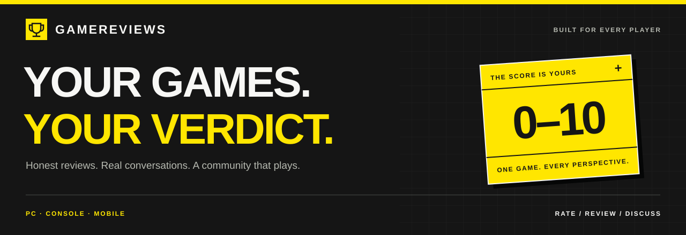
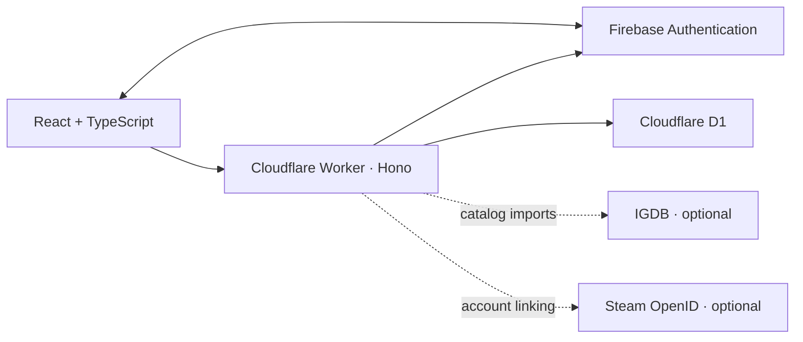

<div align="center">



**Every platform. Every player. Every opinion.**

A community for honest game ratings, thoughtful reviews, and the conversations that follow.

<p>
  <a href="https://gamereviews.gamereviews-saimadhav10.workers.dev"><strong>Visit GameReviews ↗</strong></a>
  &nbsp; · &nbsp;
  <a href="#run-it-locally">Run locally</a>
  &nbsp; · &nbsp;
  <a href="docs/DEPLOYMENT.md">Deployment guide</a>
  &nbsp; · &nbsp;
  <a href="https://github.com/saimadhav10/game-reviews/issues">Report an issue</a>
</p>

<p>
  <a href="https://github.com/saimadhav10/game-reviews/actions/workflows/checks.yml"></a>
  
  
  
  
</p>

</div>

---

## One game. Every perspective.

GameReviews brings PC, console, and mobile players together. Find a game, leave a score, write about your experience, or join a discussion. Community ratings shape the Top 50, and community votes bring the day's standout reviews and comments into view.

<table>
  <tr>
    <td width="33%" valign="top">
      <h3>🎮 Find your next game</h3>
      <p>Search the catalog and filter by platform, genre, and release year. Suggest a missing game for admin approval.</p>
    </td>
    <td width="33%" valign="top">
      <h3>✍️ Make your verdict count</h3>
      <p>Rate games from 0 to 10 in decimal increments. Leave a score alone or add a written review, and edit your verdict later.</p>
    </td>
    <td width="33%" valign="top">
      <h3>💬 Keep talking</h3>
      <p>Reply in text-only threads, upvote or downvote contributions, and conceal spoilers until readers choose to reveal them.</p>
    </td>
  </tr>
  <tr>
    <td valign="top">
      <h3>🏆 Community, ranked</h3>
      <p>A Top 50 built from GameReviews ratings, plus review and comment highlights drawn from a rolling 24-hour window.</p>
    </td>
    <td valign="top">
      <h3>🕶️ Your public identity</h3>
      <p>Use Google or email/password accounts, track your contributions, and choose anonymity across your public profile.</p>
    </td>
    <td valign="top">
      <h3>☀️ Day or night</h3>
      <p>Responsive layouts, keyboard-friendly controls, and a light/dark toggle that remembers your browser preference.</p>
    </td>
  </tr>
</table>

## The community sets the score

1. **Play, then rate.** Each verified account gets one editable score per game, from **0 to 10 in 0.1 increments**. Scores publish immediately; a written review is optional.
2. **Share your experience.** Each account can write one review per game, with threaded replies underneath. Written reviews, replies, and review edits go through admin approval. An approved review stays visible while its revision is pending.
3. **Shape what gets discovered.** Change or remove your upvote or downvote at any time. Daily highlights use eligible contributions and votes from the last 24 hours; Top 50 rankings use only this website's ratings.

The ranking eligibility threshold is adjustable by an admin. Equal averages are ordered by rating count, then game title. Public anonymity hides identity from other players; administrators retain submission ownership for moderation.

## Built for a free-plan launch

| Layer     | Technology                | Responsibility                                                |
| :-------- | :------------------------ | :------------------------------------------------------------ |
| Interface | React · TypeScript · Vite | Responsive pages, themes, forms, and client navigation        |
| API       | Hono · Cloudflare Workers | Validation, permissions, moderation, and integrations         |
| Database  | Cloudflare D1             | Games, profiles, ratings, reviews, replies, and votes         |
| Accounts  | Firebase Authentication   | Google and email/password sign-in, verification, and recovery |
| Hosting   | Cloudflare static assets  | The website bundle, fonts, and game artwork                   |
| Checks    | Vitest · GitHub Actions   | Automated behavior checks and production build validation     |



Production targets **Cloudflare Free and Firebase Spark**, using a free `workers.dev` address. Service quotas still apply. Local development needs no paid accounts or production API keys.

<details>
<summary><strong>Current catalog and integration status</strong></summary>

- **Starter catalog:** 14 real games, with metadata and artwork from their Steam Store pages. No community accounts, reviews, votes, or ratings are seeded.
- **Firebase:** the production project is connected, with Google and email/password providers configured. See the [verification notes](docs/VERIFICATION.md) for the remaining live account checks.
- **IGDB:** admin search/import is implemented; live access is awaiting provider approval and credential configuration. Imports bring in game metadata, while ratings remain native to GameReviews.
- **Steam:** optional account linking is implemented through OpenID. No Steam Web API key or playtime proof is required. A real login round trip remains to be verified.
- **Moderation:** admin queues cover reviews, replies, revisions, and game suggestions. Admin access is configured through Firebase user IDs stored server-side.
- **Policies:** the privacy and terms pages still need the website owner's final details.

</details>

## Run it locally

Use **Node.js 24 LTS** and npm.

```sh
git clone https://github.com/saimadhav10/game-reviews.git
cd game-reviews
npm ci
npm run setup:local
npm run db:migrate
npm run db:seed
npm run build
npm run dev
```

| Open                              | Address                                 |
| :-------------------------------- | :-------------------------------------- |
| Website                           | [127.0.0.1:5173](http://127.0.0.1:5173) |
| Authentication emulator dashboard | [127.0.0.1:4000](http://127.0.0.1:4000) |

The local authentication emulator supports email/password registration, verification links, password resets, and simulated Google sign-in. These development identities are separate from real accounts.

<details>
<summary><strong>Create a local administrator</strong></summary>

With the development services running, open another terminal:

```sh
npm run setup:admin-local
```

The helper writes local-only sign-in details to `.local/admin.env` and updates the ignored `.dev.vars`. It never creates a production account. Run it again after restarting the authentication emulator: emulator accounts are ephemeral, while local D1 data persists in `.wrangler/`.

</details>

## Development checks

```sh
npm run typecheck
npm test
npm run build
```

Tests use a separate authentication emulator on port **9199** and an isolated, ephemeral D1 database. They cover authentication boundaries, editable ratings, moderation and revision handling, vote changes, anonymity, rankings, daily highlights, catalog approval, Steam callback validation, and safe spoiler/text rendering. They do not mutate development or production data.

## Explore the project

```text
src/                   Pages, shared components, authentication, and themes
worker/                API routes, permissions, moderation, and integrations
shared/                Shared validation and utilities
db/                    Database migrations, metadata seed, and catalog updates
public/                Website assets and game artwork
scripts/               Development, account setup, and deployment helpers
tests/                 API behavior and text-rendering checks
docs/                  Requirements, deployment, and verification notes
uiassets/              Original design references
```

| Guide                                        | Start here for                                                |
| :------------------------------------------- | :------------------------------------------------------------ |
| [Product requirements](docs/REQUIREMENTS.md) | Community rules and agreed application behavior               |
| [Deployment](docs/DEPLOYMENT.md)             | Cloudflare, Firebase, admin access, and optional integrations |
| [Verification](docs/VERIFICATION.md)         | Completed checks and remaining validation                     |

Credentials belong in ignored local environment files and deployment secrets. Keep `.dev.vars`, secret-bearing `.env*` files, and `.local/` out of commits. The browser receives public Firebase configuration through `/api/config`; integration secrets stay server-side.

## Have an idea or found a bug?

[Open an issue](https://github.com/saimadhav10/game-reviews/issues) with the page involved, what happened, and what you expected. For code changes, describe the behavior being changed and include relevant checks in your pull request.

---

<div align="center">

**YOUR GAMES. YOUR VERDICT.**

[Find your next game ↗](https://gamereviews.gamereviews-saimadhav10.workers.dev/games)

</div>
